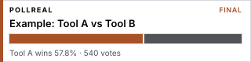
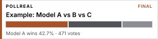
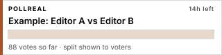

# Pollreal polls

[](https://pollreal.com)

Head-to-head votes on AI tools and products, decided by **verified humans**: one phone number per person, a passkey check (fingerprint, face or screen lock) at the moment of voting, one vote per device, no VPNs or data centres. Every poll runs for 24 hours; the result stays public with its age and gender breakdown.

This repository is the public list of polls and their live badges. It is rebuilt every day from https://pollreal.com. The Pollreal service itself is not open source.

- **See a result:** no sign-up needed.
- **Vote:** sign up once on https://pollreal.com.
- **Suggest a matchup:** create a poll at https://pollreal.com/new.

## Results as a head-to-head health bar

Lists of numbers are boring, so every Pollreal result is drawn as one bar, like the health bars in a fighting game. Each candidate holds a piece of the bar; the leader is copper, the others slate. When the lead changes, the boundary slides instead of the bar flipping. The same bar is on the poll page, the share image and the README badge.

<p>
<br>
<br>

</p>

_Illustrative numbers, not real results._ While a poll is open the split is visible only to people who voted, so the bar stays blank until it closes (third example). Real polls with live bars are listed below.

## Rankings

Scores use the Bradley–Terry model on every verified vote (the method behind the LMSYS Chatbot Arena), with 95% ranges; products are ranked from 30 votes against 3 different rivals. Full method: https://pollreal.com/rank

_Rankings appear once polls have closed._

## Help keep it fair

Pollreal is only useful if its results are hard to fake. [FAIRNESS.md](FAIRNESS.md) lists what is in place, the trade-offs, and the open questions.

- **Argue with the method:** [Discussions](https://github.com/pollreal/polls/discussions)
- **Propose a fix or report a weakness:** [Fairness proposal](https://github.com/pollreal/polls/issues/new?template=fairness.yml) (live, abusable holes: hello@pollreal.com)
- **Want a matchup?** [Suggest one](https://github.com/pollreal/polls/issues/new?template=matchup.yml)

## Polls

### AI apps & devices

| Poll | Status | Live badge |
|---|---|---|
| [Perplexity Comet vs The Browser Company Dia vs Google Chrome](https://pollreal.com/v/fv3t6wa3/comet-vs-dia-vs-chrome?via=embed) | Open until 2026-11-04 · 0 votes so far | [](https://pollreal.com/v/fv3t6wa3/comet-vs-dia-vs-chrome?via=embed) |

### Chatbots & assistants

| Poll | Status | Live badge |
|---|---|---|
| [OpenAI ChatGPT vs Anthropic Claude vs Google Gemini vs xAI Grok](https://pollreal.com/v/h9tushbq/chatgpt-vs-claude-vs-gemini-vs-grok?via=embed) | Open until 2026-11-04 · 0 votes so far | [](https://pollreal.com/v/h9tushbq/chatgpt-vs-claude-vs-gemini-vs-grok?via=embed) |

### Coding

| Poll | Status | Live badge |
|---|---|---|
| [Anysphere Cursor vs GitHub Copilot vs Cognition Devin Desktop vs Zed Industries Zed](https://pollreal.com/v/7b5zxnaq/cursor-vs-copilot-vs-devin-desktop-vs-zed?via=embed) | Open until 2026-11-04 · 0 votes so far | [](https://pollreal.com/v/7b5zxnaq/cursor-vs-copilot-vs-devin-desktop-vs-zed?via=embed) |
| [Anthropic Claude Code vs OpenAI Codex vs Google Gemini CLI](https://pollreal.com/v/6w2dhzar/claude-code-vs-codex-vs-gemini-cli?via=embed) | Open until 2026-11-04 · 0 votes so far | [](https://pollreal.com/v/6w2dhzar/claude-code-vs-codex-vs-gemini-cli?via=embed) |

### Image generation

| Poll | Status | Live badge |
|---|---|---|
| [Midjourney vs Black Forest Labs FLUX vs OpenAI GPT Image vs Google Nano Banana](https://pollreal.com/v/682jbuxx/midjourney-vs-flux-vs-gpt-image-vs-nano-banana?via=embed) | Open until 2026-11-04 · 0 votes so far | [](https://pollreal.com/v/682jbuxx/midjourney-vs-flux-vs-gpt-image-vs-nano-banana?via=embed) |

### Open source & dev tools

| Poll | Status | Live badge |
|---|---|---|
| [Meta Llama vs DeepSeek vs Alibaba Cloud Qwen vs Mistral AI Mistral](https://pollreal.com/v/dscvwzbd/llama-vs-deepseek-vs-qwen-vs-mistral?via=embed) | Open until 2026-11-04 · 0 votes so far | [](https://pollreal.com/v/dscvwzbd/llama-vs-deepseek-vs-qwen-vs-mistral?via=embed) |

### Phones & tablets

| Poll | Status | Live badge |
|---|---|---|
| [Apple iPhone vs Google Pixel vs Samsung Galaxy S](https://pollreal.com/v/teggd3cc/iphone-vs-pixel-vs-galaxy-s?via=embed) | Open until 2026-11-04 · 0 votes so far | [](https://pollreal.com/v/teggd3cc/iphone-vs-pixel-vs-galaxy-s?via=embed) |

### Search & research

| Poll | Status | Live badge |
|---|---|---|
| [Perplexity vs Google AI Mode vs OpenAI ChatGPT](https://pollreal.com/v/gewsf95e/perplexity-vs-ai-mode-vs-chatgpt?via=embed) | Open until 2026-11-04 · 0 votes so far | [](https://pollreal.com/v/gewsf95e/perplexity-vs-ai-mode-vs-chatgpt?via=embed) |

### Video generation

| Poll | Status | Live badge |
|---|---|---|
| [Google Veo vs Runway Gen-4.5 vs Kling AI Kling vs Luma AI Ray3](https://pollreal.com/v/gx729c4z/veo-vs-gen-4-5-vs-kling-vs-ray3?via=embed) | Open until 2026-11-04 · 0 votes so far | [](https://pollreal.com/v/gx729c4z/veo-vs-gen-4-5-vs-kling-vs-ray3?via=embed) |

### Voice & music

| Poll | Status | Live badge |
|---|---|---|
| [Suno vs Udio vs ElevenLabs ElevenMusic](https://pollreal.com/v/m2s4v26u/suno-vs-udio-vs-elevenmusic?via=embed) | Open until 2026-11-04 · 0 votes so far | [](https://pollreal.com/v/m2s4v26u/suno-vs-udio-vs-elevenmusic?via=embed) |

## Put a badge in your README

Every poll has a badge that updates by itself. Add `?for=N` to speak for candidate N (1 = first), or use the card with the gauge:

```markdown
[](https://pollreal.com/v/<poll-id>?via=embed)
[](https://pollreal.com/v/<poll-id>?via=embed)
```

While a poll is open its split is shown only to people who voted, so the badge says "voting"; the numbers appear when it closes.

---
Updated 2026-11-03 18:51 UTC from https://pollreal.com/api/public/polls
